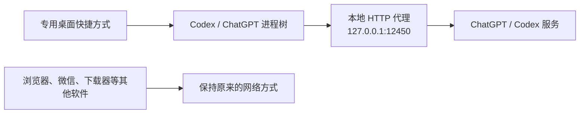

# 🚀 Codex Connectivity

> **只让 Codex 走代理，不让整台电脑走代理。**
>
> 一个面向 Windows Codex / ChatGPT Desktop 的连接增强 Skill：减少无效重连、稳定移动端 Remote Control，同时保留原有账号、内置 `openai` provider 和全部历史任务。


## ✨ 解决什么问题？

| 问题 | 处理方式 | 效果 |
|---|---|---|
| Codex 出现 `Connecting/Reconnecting 1/5 ... 5/5` | 将 HTTP、HTTPS、WS、WSS 代理仅注入 Codex 进程树 | 让 Responses WebSocket 正确经过本地代理 |
| 不想让浏览器、微信、下载器等软件消耗代理流量 | 不设置系统代理，不写入持久环境变量 | 大幅减少无关代理流量 |
| 开启“允许移动端连接”时提示“无法更新远程控制状态” | 让 Remote Control WebSocket 继承同一进程级代理 | 提高手机连接电脑端的稳定性 |
| 旧版代理 Skill 启动后看不到历史任务 | 自动移除旧版 `codex_proxy_http` provider 并恢复 `openai` | 历史记录自动重新显示，无需修改数据库 |
| Codex 更新后安装路径变化 | 启动时动态查找最新 `OpenAI.Codex` AppX | 快捷方式不绑定旧版本路径 |

## 🧭 代理范围：只有 Codex



代理变量只存在于启动脚本及其创建的 Codex 子进程中。关闭 Codex 后，这些临时变量也随进程消失。

本方案不会：

- ❌ 修改 Windows 系统代理、WinINET 或 WinHTTP
- ❌ 写入持久化的用户或系统代理环境变量
- ❌ 让其他无关软件自动消耗代理流量
- ❌ 修改注册表代理项、路由或防火墙
- ❌ 修改 `%USERPROFILE%\.ssh\config`
- ❌ 修改、迁移或删除 Codex 历史数据库

## 🗂️ 历史记录安全

### 新安装

新版安装脚本始终保留 Codex 内置的 `openai` provider，不再通过自定义 provider 强制 HTTP/SSE。正常快捷方式和代理快捷方式使用相同的 `CODEX_HOME`，因此看到的是同一批本地任务。

### 从旧版升级

旧版 Skill 曾写入：

```toml
model_provider = "codex_proxy_http"
```

Codex 的任务列表默认按当前 provider 过滤。原任务仍属于 `openai`，因此切换 provider 后会看起来“全部消失”，但数据实际上没有被删除。

再次运行新版安装脚本时会自动：

1. 备份当前 `config.toml`
2. 删除仅由旧版 Skill 管理的 provider 配置块
3. 将旧版 `codex_proxy_http` 选择恢复为 `openai`
4. 保留所有 session JSONL、`state_5.sqlite` 和账号数据

用户无需额外执行历史修复命令。

## 🔄 Codex 更新以后怎么办？

普通 Microsoft Store / AppX 更新后，继续使用原来的代理快捷方式即可，不需要重新创建。

启动器每次运行都会：

1. 动态查找版本号最高的 `OpenAI.Codex` AppX 包
2. 启动该版本中的 `app\ChatGPT.exe`
3. 重新注入 HTTP、HTTPS、WS、WSS、ALL 和 NO proxy 变量
4. 继续使用原来的 `CODEX_HOME` 和历史任务
5. 如果快捷方式图标仍指向旧版 WindowsApps 路径，自动刷新为最新版图标

桌面快捷方式始终指向稳定的 PowerShell 启动器，而不是某个固定版本的 `ChatGPT.exe`。图标刷新失败也不会阻止 Codex 启动。

只有以下情况才需要再次运行 Skill：

- 启动器来自旧版，缺少 `WS_PROXY/WSS_PROXY` 或 `--disable-quic`
- 快捷方式不再指向生成的启动器
- OpenAI 更新了网络实现，并且新日志再次出现固定 `1/5 → 5/5`

可以直接请求：

```text
使用 $codex-connectivity 检查 Codex 更新后的代理快捷方式。
保留历史记录，不要设置全局代理。
```

## 📱 改善移动端 Remote Control

在部分需要代理的网络中，打开 **设置 → 连接 → 控制此电脑 → 允许连接** 时，可能出现：


模型 Responses 和 Remote Control 都可能使用 WebSocket，但它们是不同的连接路径。启动器会同时设置：

```text
HTTP_PROXY / HTTPS_PROXY
WS_PROXY / WSS_PROXY
ALL_PROXY / NO_PROXY
```

这些变量只属于 Codex 进程树，因此既能帮助模型连接和 Remote Control 使用本地代理，也不会扩大到整台电脑。

> [!NOTE]
> 最终稳定性仍取决于本地代理节点、WebSocket CONNECT 支持、网络质量和账号功能可用性。本 Skill 不会关闭 Remote Control，也不会删除移动端配对记录。

## 🧠 为什么会出现五次 Connecting？

部分网络可以通过 HTTP 代理访问 HTTPS，却没有让 Codex 的 Responses WebSocket 正确使用该代理。Codex 会连续尝试后再回退，界面因此显示：

```text
Reconnecting... 1/5
Reconnecting... 2/5
Reconnecting... 3/5
Reconnecting... 4/5
Reconnecting... 5/5
```

本 Skill 将 HTTP、HTTPS、WS、WSS 和 Chromium 代理参数一次性注入专用快捷方式启动的 Codex 进程，同时保留内置 `openai` provider。这样既处理连接路径，也不会因为 provider 变化隐藏历史任务。

## 📦 安装为 Codex Skill

```powershell
git clone https://github.com/zhenyangLab/codex-proxy.git `
  "$env:USERPROFILE\.codex\skills\codex-connectivity"
```

重新打开 Codex 后，可以直接请求：

```text
使用 $codex-connectivity，给 Windows Codex 配置 127.0.0.1:12450。
只让 Codex 走代理，保留历史记录，并改善移动端连接。
```

## 🛠️ 手动运行

### 1. 只读预览

```powershell
powershell.exe -NoProfile -ExecutionPolicy Bypass `
  -File ".\scripts\install-codex-proxy-shortcut.ps1" `
  -ProxyHost "127.0.0.1" `
  -ProxyPort 12450 `
  -WhatIf
```

### 2. 创建或升级快捷方式

```powershell
powershell.exe -NoProfile -ExecutionPolicy Bypass `
  -File ".\scripts\install-codex-proxy-shortcut.ps1" `
  -ProxyHost "127.0.0.1" `
  -ProxyPort 12450
```

默认生成：

```text
桌面快捷方式：
%USERPROFILE%\Desktop\Codex-HTTP-Proxy-12450.lnk

启动脚本：
D:\Codex\codex-proxy-shortcuts\127.0.0.1-12450\Launch-Codex-With-Proxy.ps1
```

代理暂未启动、但需要预先创建文件时：

```powershell
powershell.exe -NoProfile -ExecutionPolicy Bypass `
  -File ".\scripts\install-codex-proxy-shortcut.ps1" `
  -ProxyHost "127.0.0.1" `
  -ProxyPort 12450 `
  -SkipProxyCheck
```

## ✅ 使用步骤

1. 完全退出 Codex / ChatGPT，包括后台进程。
2. 确认本地 HTTP 代理正在监听指定端口。
3. 运行一次新版安装脚本；旧版 provider 配置会自动安全恢复。
4. 通过新建的专用快捷方式启动 Codex。
5. 确认原有历史任务仍然显示，并发起新请求检查是否还有固定五次重连。
6. 如需移动端控制，在 Codex 连接设置中重新启用“允许连接”。

## 🔐 安全设计

- 新安装不会修改 `config.toml`
- 仅在发现旧版托管 provider 时修改配置，并先创建时间戳备份
- 默认只允许 `127.0.0.1`、`localhost` 或 `::1` 代理
- 启动器检测到 Codex 已运行时会停止并提示完全退出
- 支持 `-WhatIf` 预览将执行的操作
- 不修改 Remote Control 配对、线程数据库或 SSH 配置

## 📁 文件结构

```text
codex-proxy/
├── README.md
├── SKILL.md
├── agents/
│   └── openai.yaml
├── assets/
│   └── remote-control-error.png
├── references/
│   └── connectivity-diagnosis.md
└── scripts/
    └── install-codex-proxy-shortcut.ps1
```

## 📚 相关资料

- [Codex configuration reference](https://developers.openai.com/codex/config-reference/)
- [Codex thread-list provider filtering](https://github.com/openai/codex/blob/main/codex-rs/app-server/src/request_processors/thread_processor.rs)
- [Responses WebSocket retries before HTTP fallback](https://github.com/openai/codex/issues/19821)
- [Provider-preserving HTTPS-only option request](https://github.com/openai/codex/issues/28503)
