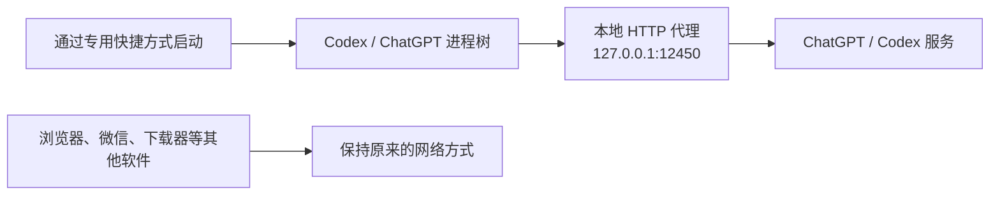
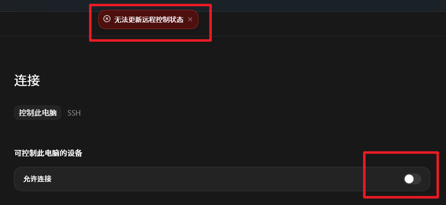

# 🚀 Codex Connectivity

> **只让 Codex 走代理，而不是让整台电脑走代理。**
>
> 一个 Windows Codex / ChatGPT Desktop 连接增强 Skill：节省代理流量、消除固定五次重连，并改善移动端 Remote Control 的连接稳定性。


## ✨ 解决什么问题？

| 问题 | 处理方式 | 效果 |
|---|---|---|
| Codex 每次先 `Connecting/Reconnecting 1/5 ... 5/5` | 模型请求直接使用 HTTP/SSE | 跳过失败的 Responses WebSocket 重试 |
| 不想让微信、浏览器、下载器等软件消耗代理流量 | 代理变量只注入快捷方式启动的 Codex 进程树 | 大幅减少不必要的代理流量消耗 |
| 开启“允许移动端连接”时提示“无法更新远程控制状态” | 让 Remote Control WebSocket 继承 Codex 进程级代理 | 在需要代理的网络中提高移动端连接稳定性 |
| Codex 更新后安装路径变化 | 启动时动态查找最新 `OpenAI.Codex` AppX | 快捷方式无需绑定旧版本路径 |

## 🎯 最重要的区别：不是全局代理

本方案不会让整台电脑的流量都经过代理。



代理变量只存在于专用启动器及其启动的 Codex 进程树中。关闭 Codex 后，这些临时变量随进程一起消失。

因此它不会：

- ❌ 修改 Windows 系统代理、WinINET 或 WinHTTP。
- ❌ 写入持久化的用户或系统代理环境变量。
- ❌ 让其他无关软件自动消耗代理流量。
- ❌ 修改注册表代理项、路由或防火墙。
- ❌ 修改 `%USERPROFILE%\.ssh\config`。

## 📱 改善移动端 Remote Control

在部分需要代理的网络中，打开 **设置 → 连接 → 控制此电脑 → 允许连接** 时，可能出现下面的错误：



模型响应和 Remote Control 使用的是两条不同连接：

- **模型响应**：本 Skill 配置为 HTTP/SSE，避免 Responses WebSocket 固定重试五次。
- **Remote Control**：仍使用 WebSocket，但通过 `WS_PROXY/WSS_PROXY` 继承同一个本地代理。

因此，使用专用快捷方式启动后，不仅可以解决五次 Connecting，还可解决这类代理网络下的“无法更新远程控制状态”，让手机端连接电脑端更加稳定。

> [!NOTE]
> 连接效果仍取决于本地代理节点、网络质量和 GitHub/OpenAI 账户功能是否可用。本 Skill 不会删除 Remote Control 注册信息，也不会修改 SSH 配置。

## 🧠 为什么会出现五次 Connecting？

部分 HTTP 代理能够正常转发 HTTPS/SSE，却无法稳定转发 Codex Responses WebSocket。Codex 默认先尝试 WebSocket，连续失败后才回退到 HTTP，于是界面反复显示：

```text
Reconnecting... 1/5
Reconnecting... 2/5
Reconnecting... 3/5
Reconnecting... 4/5
Reconnecting... 5/5
```

本 Skill 使用两层配置：

1. 创建兼容 ChatGPT 登录的 HTTP/SSE provider，并设置 `supports_websockets = false`。
2. 创建 Windows 桌面快捷方式，仅向 Codex 进程树注入 HTTP、HTTPS、WS、WSS 和 Chromium 代理参数。

## 📦 安装为 Codex Skill

将仓库克隆到个人 Skill 目录，目录名使用 `codex-connectivity`：

```powershell
git clone https://github.com/zhenyangLab/codex-proxy.git `
  "$env:USERPROFILE\.codex\skills\codex-connectivity"
```

重新打开 Codex 后，可以直接请求：

```text
使用 $codex-connectivity，给 Windows Codex 配置 127.0.0.1:12450，
解决五次 Connecting、限制代理范围，并改善移动端连接。
```

## 🛠️ 手动运行

### 1. 先执行只读预演

```powershell
powershell.exe -NoProfile -ExecutionPolicy Bypass `
  -File ".\scripts\install-codex-proxy-shortcut.ps1" `
  -ProxyHost "127.0.0.1" `
  -ProxyPort 12450 `
  -WhatIf
```

### 2. 确认目标正确后执行

```powershell
powershell.exe -NoProfile -ExecutionPolicy Bypass `
  -File ".\scripts\install-codex-proxy-shortcut.ps1" `
  -ProxyHost "127.0.0.1" `
  -ProxyPort 12450
```

默认生成：

```text
桌面快捷方式：
%USERPROFILE%\Desktop\Codex-HTTP-Proxy-12450.lnk

启动脚本：
D:\Codex\codex-proxy-shortcuts\127.0.0.1-12450\Launch-Codex-With-Proxy.ps1
```

如果代理暂时没有运行，但需要预先创建文件：

```powershell
powershell.exe -NoProfile -ExecutionPolicy Bypass `
  -File ".\scripts\install-codex-proxy-shortcut.ps1" `
  -ProxyHost "127.0.0.1" `
  -ProxyPort 12450 `
  -SkipProxyCheck
```

## ✅ 使用步骤

1. 完全退出 Codex / ChatGPT，包括后台进程。
2. 确认本地 HTTP 代理已经监听指定端口。
3. 通过新创建的专用快捷方式启动 Codex。
4. 发起一个新请求，确认不再出现固定五次重连。
5. 如需移动端控制，在 Codex 的连接设置中重新开启“允许连接”。

## 🔒 安全设计

- 修改 `config.toml` 前自动生成带时间戳的备份。
- 默认只允许 `127.0.0.1`、`localhost` 或 `::1` 代理。
- Codex 已运行时，启动器会停止并提示先完全退出，避免参数未生效。
- 支持 `-WhatIf` 检查将要修改的文件。
- 不自动关闭 Remote Control，不删除移动端配对记录。

## 📁 文件结构

```text
codex-proxy/
├── README.md
├── SKILL.md
├── agents/
│   └── openai.yaml
├── assets/
│   └── remote-control-error.png
├── references/
│   └── connectivity-diagnosis.md
└── scripts/
    └── install-codex-proxy-shortcut.ps1
```

## 📚 相关资料

- [Codex configuration reference](https://developers.openai.com/codex/config-reference/)
- [Responses WebSocket retries before HTTP fallback](https://github.com/openai/codex/issues/19821)
- [HTTP-only provider workaround](https://github.com/openai/codex/issues/22634)
